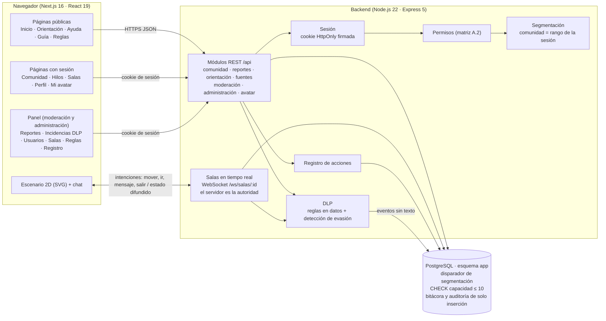

# Arquitectura en una página

Prototipo local (TRL 4, datos sintéticos). Tres piezas: el navegador, el backend y la base de datos. **El backend es el único que toca los datos** y es donde se aplican la segmentación por edad, los permisos y el DLP.

## Cómo viaja una acción

1. **Publicar un hilo.** El navegador envía título y contenido, nunca la comunidad. El backend lee la sesión, toma la comunidad del rango, pasa el texto por el DLP (incluidas sus variantes contra evasión) y, si no hay bloqueo, guarda. La base vuelve a comprobar que el hilo sea de la comunidad de la persona.
2. **Moverse en una sala.** El navegador envía una intención (`mover` con una dirección o `ir` a una casilla). El servidor calcula el camino, valida cada paso contra límites y obstáculos y difunde la posición a todos los de la sala.
3. **Moderar un reporte.** El panel pide el reporte; el backend comprueba el permiso, devuelve el motivo y el contenido (sin decir quién reportó) y aplica la acción en una sola sentencia SQL junto con su registro de auditoría.

## Decisiones clave

| Tema              | Elección                                                                                                       |
| ----------------- | -------------------------------------------------------------------------------------------------------------- |
| Datos             | PostgreSQL con SQL directo (`pg`), migraciones numeradas y seed sintético.                                     |
| Autenticación     | Selector de usuarios sintéticos (solo demo) y cookie firmada. La verificación de edad está pendiente.          |
| Tiempo real       | WebSocket (`ws`) en el mismo servidor; estado en memoria de un proceso.                                        |
| Interfaz          | CSS Modules con tokens, `motion` para animaciones (respeta «reducir movimiento») y `lucide-react` para iconos. |
| Recursos gráficos | Pixel art propio dibujado por código; fuentes OFL alojadas en el proyecto.                                     |

Detalle completo en [`DECISIONES.md`](../DECISIONES.md) y el modelo de datos en [`MODELO_DE_DATOS.md`](MODELO_DE_DATOS.md).
