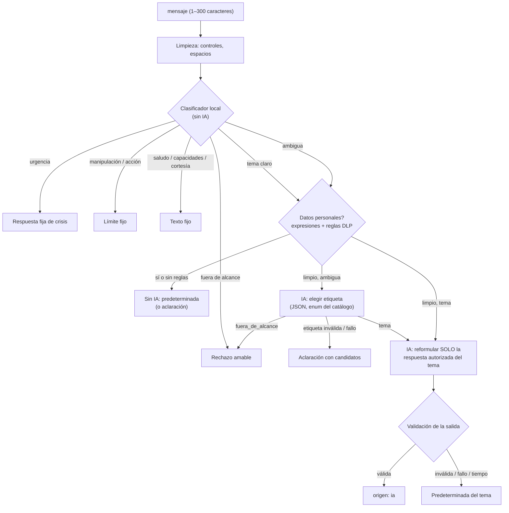

# Cocuyo con IA: intenciones permitidas y control de alcance

Cocuyo es la guía de inicio de la plataforma (F25): el botón flotante **¿Cómo funciona?**, presente en las páginas públicas y de comunidad, y la sección **Pregúntale a Cocuyo** de `/guia` (en móvil y tableta no hay botón flotante). Antes respondía solo con siete botones de respuestas preparadas; ahora la persona también puede **escribir en lenguaje natural**. Los botones siguen ahí como accesos rápidos dentro del chat y responden al instante, sin red ni IA, con el mismo texto de siempre.

Cocuyo **solo responde los temas de su catálogo**. La restricción no depende de las instrucciones del modelo: se aplica en el backend antes y después de llamar a la IA.

> No confundir con el **Asistente de orientación** (`/asistente`, `modules/asistente-usuario`), que es otra función, solo para cuentas de jóvenes, y que no se modificó.

## Auditoría: qué hacía Cocuyo antes

| Pieza                                                             | Qué hace                                                                                                                                                                                                                                                                               |
| ----------------------------------------------------------------- | -------------------------------------------------------------------------------------------------------------------------------------------------------------------------------------------------------------------------------------------------------------------------------------- |
| `components/guia/GuiaVirtual.tsx`                                 | Botón flotante y ventana. Mostraba la presentación, los **consejos de esta página** (reabren el globo de Cocuyo o Chigüi, con el interruptor de consejos automáticos) y la lista de las siete preguntas. Al elegir una, mostraba su respuesta y «Otras preguntas». Sin campo de texto. |
| `config/guia.ts`                                                  | `PRESENTACION_GUIA` y los siete temas (`TEMAS_GUIA`): pregunta, párrafos, enlace opcional y `conCanales`.                                                                                                                                                                              |
| `components/guia/ContenidoTema.tsx`                               | Pinta una respuesta; con `conCanales` trae hasta tres canales institucionales reales (`GET /api/orientacion/ayuda`) con fuente y fecha.                                                                                                                                                |
| `app/guia/page.tsx` + `PreguntasFrecuentes.tsx`                   | Página «Cómo funciona» con los mismos siete temas en acordeón.                                                                                                                                                                                                                         |
| `components/guia/MensajeContextual.tsx`, `config/acompanantes.ts` | Globos automáticos de Cocuyo y Chigüi por página. No responden preguntas: no cambian.                                                                                                                                                                                                  |
| `components/inicio/ValleComunidades.tsx`, `Cocuyo.tsx`            | Solo el dibujo del personaje.                                                                                                                                                                                                                                                          |

Infraestructura de IA existente que se reutiliza: proveedor OpenAI por `fetch` desde el backend, clave en `OPENAI_API_KEY` (o la variable heredada `openai`) y modelo en `OPENAI_MODEL` (`config.openai`), inyección de `fetcher` para las pruebas, limitador en memoria (`seguridad/limitador.ts`), reglas DLP activas (`dlp.analizador` + `dlp.repository`, sin modificar el módulo) y el detector de urgencias del asistente de orientación (`esCrisis`).

## Inventario de intenciones (fuente de verdad)

El catálogo vive en `apps/backend/src/modules/cocuyo/cocuyo.catalogo.ts`. El frontend tiene el mismo contenido en `config/guia.ts` porque lo necesita para responder los accesos rápidos sin red; `test/cocuyo-catalogo.test.ts` exige que ambos sean idénticos (ids, preguntas, textos, enlaces y orden). Los servicios de Vercel se despliegan por separado (`apps/backend` y `apps/frontend`), así que no se comparte un archivo entre ambos.

### Temas (respuesta autorizada = texto original de la guía)

| Id            | Acceso rápido                      | Cubre                                                                                     | Enlace / extra                      |
| ------------- | ---------------------------------- | ----------------------------------------------------------------------------------------- | ----------------------------------- |
| `que-es`      | ¿Qué es esta plataforma?           | Qué es, para qué sirve, de dónde sale la información institucional.                       | Ir a Orientación (`/orientacion`)   |
| `comunidad`   | ¿Quién puede ver lo que publico?   | Comunidades por rango de edad, visibilidad de hilos, perfil y salas, alias, avatar, edad. | Ir a mi comunidad (`/comunidad`)    |
| `privacidad`  | ¿Por qué no se publicó mi mensaje? | Filtro de datos personales, qué pasa con el texto bloqueado, reportes y moderación.       | —                                   |
| `salas`       | ¿Cómo funcionan las salas?         | Tema fijo, capacidad, reglas, mover el avatar, salir, cierre de salas vacías.             | Ver las salas (`/salas`)            |
| `reportar`    | ¿Qué hago si algo me incomoda?     | Reportar, motivo, revisión de moderación, anonimato de quien reporta.                     | Leer las reglas (`/reglas`)         |
| `orientacion` | ¿Dónde encuentro orientación?      | Canales de instituciones con fuente y fecha.                                              | Necesito ayuda (`/ayuda`) + canales |
| `limites`     | ¿Qué no puede hacer la plataforma? | No diagnostica, no reemplaza atención profesional, no es canal oficial.                   | —                                   |

### Intenciones de conversación (texto fijo, sin IA)

| Id            | Ejemplos                                                | Respuesta                                     |
| ------------- | ------------------------------------------------------- | --------------------------------------------- |
| `saludo`      | «hola», «buenas tardes»                                 | La presentación de la guía + todos los temas. |
| `capacidades` | «¿quién eres?», «¿qué puedes hacer?», «¿eres un robot?» | Qué es Cocuyo y la lista de temas.            |
| `cortesia`    | «gracias», «listo», «chao»                              | Cierre breve.                                 |

### Respuestas de reserva (texto fijo, sin IA)

| Caso                    | Cuándo                                                                                     | Qué responde                                                                          |
| ----------------------- | ------------------------------------------------------------------------------------------ | ------------------------------------------------------------------------------------- |
| `crisis`                | Posible peligro inmediato (suicidio, autolesión, violencia).                               | Buscar a una persona de confianza o emergencias, enlace a «Necesito ayuda» y canales. |
| `limite` (manipulación) | Cambiar de rol, ignorar instrucciones, revelar el prompt, marcas `<system>`, `###`…        | «Sigo siendo Cocuyo y mis reglas no cambian…» + temas.                                |
| `limite` (acción)       | Pedir que haga cosas: buscar en internet, enviar correos, cambiar cuentas, datos de otros… | «No puedo hacer acciones por ti…» + temas.                                            |
| `fuera_de_alcance`      | Programación, política, entretenimiento, noticias, tareas, opiniones, dinero, recetas…     | Rechazo amable + temas.                                                               |
| `aclaracion`            | Ambigua o sin sentido.                                                                     | Pide reformular y ofrece los temas candidatos (o todos).                              |
| Aviso de privacidad     | El mensaje trae datos personales.                                                          | Se responde con la predeterminada del tema y se pide no escribir datos personales.    |
| Mezcla                  | Tema claro + algo ajeno («¿cómo funcionan las salas? y quién ganó el partido»).            | Responde el tema y avisa que lo demás no lo atiende.                                  |

Decisión de alcance: los globos de consejos de cada página (juegos, perfil, reglas…) siguen accesibles desde «Consejos de esta página», pero **no** se convirtieron en temas del chat. Cocuyo solo responde los siete temas que ya respondía.

## Flujo en el backend (`POST /api/guia/cocuyo`)



1. **Clasificador local** (`cocuyo.clasificador.ts`, puro): urgencia → manipulación → pedido de acciones → fuera de alcance → tema → conversación → ambigua. Compara palabras sin tildes, con una clave fonética del español (b/v, s/z/c, k/qu, j/g, h muda, ll/y, letras repetidas), abreviaturas de chat (q, xq, pa, msj…) y una distancia de edición pequeña, así que entiende «kien puede ber lo q publico» o «como funsionan las salaz». Elige un tema si su puntaje es al menos 2 y supera al segundo; si no, es ambigua.
2. **Privacidad** (`cocuyo.privacidad.ts`): expresiones propias (correo, teléfono, «me llamo», «tengo 14 años») y las **reglas DLP activas de la base** (categorías contacto, ubicación, identidad y edad, o cualquier regla de bloqueo), con caché de 60 s. No registra eventos DLP: el mensaje no se publica. Si las reglas no se pueden leer, **falla cerrado**: nada sale hacia la IA. Las reglas de convivencia (`lenguaje_ofensivo` y `contenido_sexual`, migración 0008) se evalúan aparte: una grosería **no** recibe el aviso de datos personales, pero el mensaje tampoco sale hacia la IA (resultado `ofensivo`); se responde con la predeterminada del tema o con una aclaración.
3. **Clasificación con IA** (solo si es ambigua): el modelo recibe la lista de etiquetas con su descripción (nunca las respuestas) y debe devolver `{"intencion": …}` con `response_format` JSON estricto. El backend vuelve a comprobar que la etiqueta exista; cualquier otra cosa se descarta.
4. **Generación**: el modelo recibe solo la respuesta autorizada del tema elegido y la pregunta como dato delimitado (sin `<>`, comillas ni llaves) y la reformula en máximo 4 oraciones.
5. **Validación de la salida** (`cocuyo.validacion.ts`): rechaza si está vacía o pasa de 600 caracteres; trae URLs, dominios, correos o rutas; formato (código, etiquetas, llaves); teléfonos; cifras (en dígitos o en palabras) que no estén en la fuente; textos entre comillas que no existan en la fuente (nombres de botones); nombres propios nuevos; términos sensibles ausentes de la fuente (salud, política, dinero, redes, emergencias, detalles del modelo o de las instrucciones, entretenimiento); o más de un 30 % de vocabulario ajeno. Si falla, se usa la respuesta predeterminada y se registra solo el motivo.
6. **Tiempo y costo**: 7 s como máximo para todas las llamadas de una pregunta (3 s para clasificar), presupuesto de 60 llamadas por minuto por proceso y límite de 10 preguntas por minuto por cuenta o, sin sesión, por IP (429 con `Retry-After`). Sin clave de IA, con el proveedor caído, con error, con respuesta vacía o con tiempo agotado, Cocuyo responde la predeterminada: **la ruta nunca devuelve error por la IA**.

La ruta es pública (la guía aparece sin sesión), valida el cuerpo con zod (`{ mensaje }`, estricto) y pasa por la verificación de origen y los encabezados de seguridad de toda la API. No se guardan conversaciones ni se registra el texto: los registros solo llevan intención y motivo técnico. Cada pregunta se clasifica sola; el historial no viaja al servidor.

Respuesta:

```json
{
  "tipo": "respuesta",
  "intencion": "salas",
  "texto": "…",
  "origen": "ia",
  "enlace": { "href": "/salas", "texto": "Ver las salas" },
  "conCanales": false,
  "sugerencias": [],
  "aviso": null
}
```

## Frontend

- `components/guia/ChatCocuyo.tsx`: chat reutilizable (`useConversacionCocuyo` + `ChatCocuyo`). Accesos rápidos con las siete preguntas al inicio, en las respuestas que sugieren temas y en una barra sobre el campo de texto. Un acceso rápido muestra el texto preparado al instante. Las respuestas con IA dicen «Redactada con IA a partir de la respuesta preparada» y permiten ver el original. Mientras espera, el resto de la interfaz sigue disponible; si el backend no responde o hay límite, Cocuyo lo dice y ofrece las preguntas frecuentes.
- `GuiaVirtual.tsx`: la ventana flotante ahora contiene el chat; los consejos de la página y su interruptor se conservan. La conversación se mantiene al cerrar y abrir la ventana mientras la página esté abierta; el botón de reinicio la borra.
- `/guia`: nueva sección «Pregúntale a Cocuyo» (la forma de conversar en móvil y tableta). El acordeón de preguntas frecuentes no cambia.

## Pruebas

- `test/cocuyo.test.ts` (unitarias, proveedor simulado con el mismo `fetcher` inyectado que los asistentes): las siete preguntas originales, reformulaciones, errores ortográficos y coloquialismos, fuera de alcance, ambiguas, urgencias, prompt injection, pedidos para ampliar capacidades, etiquetas inventadas por la IA, respuestas inventadas que la validación descarta (enlaces, cifras, teléfonos, nombres, temas, instrucciones, formato, longitud, vocabulario), fallo HTTP, error de red, respuesta vacía, tiempo agotado, presupuesto, privacidad (expresiones, reglas DLP del seed, fallo cerrado), contexto limitado al tema y la ruta (pública, validación, 429).
- `test/cocuyo-catalogo.test.ts`: el catálogo del backend y `config/guia.ts` son idénticos.
- `test/integracion/cocuyo.test.ts` (`npm run test:db`): ruta completa con PostgreSQL, reglas DLP de la base sin registrar eventos, fallo del proveedor y verificación de origen.

Para agregar o cambiar un tema: edita el texto en **ambos** catálogos, ajusta sus `senales` y `descripcion` en el backend, agrega casos a `test/cocuyo.test.ts` y corre `npm test`.
